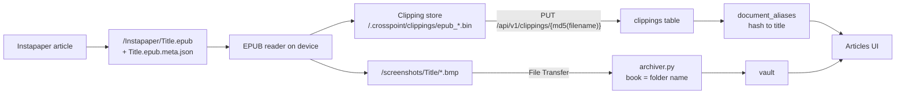

# Articles: Instapaper ingest

How Instapaper articles reach this service, which firmware contracts make that
work without a new protocol, and where the existing book-shaped model breaks.

Three repositories are referenced:

| Short name | Path |
|---|---|
| service | `/srv/docker/compose/xteink-x4/xteink-x4-commonplace-tool` (this repo) |
| firmware | `/home/ghostbird/crosspoint-reader` |
| plugin | `/home/ghostbird/instapaper.crosspoint-plugin` |

Line references below were checked against the working trees on 2026-11-07.

---

## 1. What the Instapaper plugin produces

One EPUB 3 per article, written to `/Instapaper/` on the SD card. Each file is a
single spine item holding a single chapter (`src/epub.js:259`,
`<spine toc="ncx"><itemref idref="article"/></spine>`). The destination folder is
fixed in two places: `DEST_DIR = '/Instapaper'` (`src/plugin.js:19`) and
`"dest_dir": "/Instapaper"` in the on-device catalog manifest
(`instapaper.crosspoint-plugin/device.json`).

### Filename

`<sanitized dc:title>.epub`. The plugin reimplements the firmware's own
`StringUtils::sanitizeFilenamePreservingExtension` as `readerFileName()`
(`src/epub.js:383-408`), so a download made in the browser and a download made by
the reader's catalog land on the same name.

| Rule | Plugin | Firmware |
|---|---|---|
| Byte budget for the stem | `100 - '.epub'.length - suffix` = 95 with no suffix (`src/epub.js:391`) | `maxBytes - extensionBytes`, `maxBytes` default 100 (`src/util/StringUtils.cpp:64-74`, `src/util/StringUtils.h:41`) |
| `/ \ : * ? " < > \|` | replaced with `_` (`src/epub.js:398`) | replaced with `_` (`src/util/StringUtils.cpp:36-40`) |
| Control characters | dropped (`src/epub.js:399-400`) | dropped (same range test) |
| Leading spaces and dots | skipped before the budget is charged (`src/epub.js:394`) | skipped (`src/util/StringUtils.cpp:26-29`) |
| Trailing spaces and dots | trimmed (`src/epub.js:406`) | trimmed (`src/util/StringUtils.cpp:48-53`) |
| Truncation point | whole UTF-8 character (`src/epub.js:401-404`) | whole codepoint (`src/util/StringUtils.cpp:31-46`) |
| Empty result | `'book'` (`src/epub.js:407`) | `"book"` (`src/util/StringUtils.cpp:56`) |

A ` (<bookmark id>)` suffix is appended **only** when the name already exists on
the card (`src/plugin.js:336-338`). The suffix is charged against the 95-byte
stem budget, so a collision also shortens the title. Steady state: the filename
is a pure function of `dc:title`.

### Sidecar

`<file>.epub.meta.json`, containing exactly `{"instapaper_id":"<id>"}`. Written
by the in-page sync (`src/plugin.js:89-91`) and by the catalog download path via
the manifest sidecar template (`instapaper.crosspoint-plugin/device.json`,
`"path": "{dest}.meta.json"`, `"body": "{\"instapaper_id\":\"{id}\"}"`).

### OPF metadata

Built in `epubFiles()` (`src/epub.js:189-213`).

| Element | Value |
|---|---|
| `dc:identifier` | `urn:instapaper:bookmark:<id>` (`src/epub.js:191`, `:200`) |
| `dc:title` | article title, whitespace-normalized, `'Untitled article'` when empty (`src/epub.js:190`, `:201`) |
| `dc:creator` | author, falling back to the site hostname (`src/epub.js:202`) |
| `dc:source` | original article URL (`src/epub.js:204`) |
| `dc:description` | Instapaper description, when present (`src/epub.js:205`) |
| `dc:date` | publication date, `YYYY-MM-DD` (`src/epub.js:206`) |
| `dcterms:modified` | build wall-clock (`src/epub.js:207`) |

### Determinism

The EPUB is **not** byte-deterministic. ZIP entry mtimes are hardcoded to
1980-01-01 00:00 (`DOS_DATE`, `src/epub.js:334`) and there are no generated
UUIDs: `dc:identifier` is derived from the bookmark id. The only in-file source
of variance is `dcterms:modified`, taken from `now` at build time
(`src/epub.js:378-381`). Externally, the Worker's image set can vary between
fetches of the same article. Consequence: re-downloading an article produces a
file with the same name and different bytes. See section 2.

### Highlights

The plugin has **no clipping-sync client**. It reads the firmware's clipping
store files directly in the browser, parsing `/.crosspoint/clippings/epub_*.bin`
(`src/plugin.js:390`, `:395-440`, `:460-462`) and POSTs the text to Instapaper's
own `/bookmarks/<id>/highlights` API (`src/plugin.js:453-500`). It resolves the
bookmark id by reading `store.path + '.meta.json'` (`src/plugin.js:470`).

This is independent of this service. The plugin never contacts a kosync or
clipping-sync server, and this service never writes to the SD card. Both can run
against the same clipping store with no conflict; the only shared state is the
on-card `.bin` file, which the plugin opens read-only.

### Worker state

The Cloudflare Worker is stateless. `wrangler.jsonc` declares `name`, `main`,
`compatibility_date`, and `workers_dev` only: no KV namespace, D1 database, R2
bucket, or Durable Object bindings. All persistent state is SD-card-local (the
EPUBs, their sidecars, and the plugin's own `download.json` state file).

---

## 2. Firmware contracts that make this work

### Sync keys off the SD path, not the origin

Clipping sync is invoked with `(bookPath, documentHash)` and builds its URL from
the hash alone: `getBaseUrl() + "/api/v1/clippings/" + documentHash`
(`src/clippings/ClippingSync.cpp:157`). The on-card clipping store file is named
from a hash of the book's file path (`src/ClippingStore.cpp:37-40`). Nothing in
either path consults where the book came from, so a plugin-delivered EPUB syncs
exactly like a sideloaded or OPDS book. No service-side change is needed to
accept articles.

Clippings are EPUB-only: the store is loaded with the literal book type `"epub"`
(`src/clippings/ClippingSync.cpp:138`) and `clippingSync::run` is reachable from
exactly one call site, inside the EPUB reader's sync activity
(`src/activities/reader/KOReaderSyncActivity.cpp:189`). Articles are EPUBs, so
they qualify.

### Document hashing

Two methods, selected by one setting (`DocumentMatchMethod`,
`lib/KOReaderSync/KOReaderCredentialStore.h:11-14`).

| Method | Input | Algorithm |
|---|---|---|
| `FILENAME` (0) | basename including extension | plain MD5 (`lib/KOReaderSync/KOReaderDocumentId.cpp:18-32`) |
| `BINARY` (1) | file bytes | MD5 over 12 chunks of 1024 bytes read at offsets `0`, then `1024 << 2i` for `i = 0..10` (`lib/KOReaderSync/KOReaderDocumentId.cpp:34-80`, `KOReaderDocumentId.h:38-44`) |

`BINARY` reads at most 12 KiB. Offsets at or beyond EOF are skipped; the final
chunk is truncated to the file size.

Behaviour when an article is re-downloaded under the same title:

| | Filename | Bytes | FILENAME hash | BINARY hash |
|---|---|---|---|---|
| First download | `Title.epub` | A | `H` | `X` |
| Re-download (new `dcterms:modified`, possibly different images) | `Title.epub` | B | `H`, unchanged | `Y`, changed |

**Match Method must be set to Filename for articles.** Under Binary, every
re-fetch of an article mints a new document hash, orphaning that article's entire
clipping history and reading position behind a hash nothing will ever ask for
again. Filename is the shipped default (`matchMethod = DocumentMatchMethod::FILENAME`,
`lib/KOReaderSync/KOReaderCredentialStore.h:46`; invalid persisted values also
reset to it, `KOReaderCredentialStore.cpp:79-85`).

Clipping sync is worse off than progress sync here. Progress sync tries the
alternate method's hash when the primary misses
(`src/activities/reader/KOReaderSyncActivity.cpp:219-220`), but clipping sync is
handed the primary hash only (`:162-163`, `:189`) and has no fallback.

### Correction to CLAUDE.md: clipping sync is not gated on Server Type

`CLAUDE.md` currently states "Clipping sync requires Server Type != KOSync and
Sync Clippings on". The first half is wrong and should be removed.

`src/clippings/ClippingSync.cpp` contains no reference to `KOReaderServerType`,
`supportsRichProgress`, `supportsExtendedMetadata`, or `getMatchMethod`. Its only
gate is:

```cpp
if (!KOREADER_STORE.getSyncClippings()) return true;
if (!KOREADER_STORE.hasCredentials()) return false;
```

(`src/clippings/ClippingSync.cpp:136-137`). The enclosing call site is gated the
same way (`src/activities/reader/KOReaderSyncActivity.cpp:176`).

Server Type gates two unrelated things only:

```cpp
bool supportsRichProgress() const { return serverType != KOReaderServerType::KOSYNC; }
bool supportsExtendedMetadata() const { return serverType == KOReaderServerType::OTHER; }
```

(`lib/KOReaderSync/KOReaderCredentialStore.h:93-94`). Those control the rich
`position` object and the extended `metadata` fields on the progress payload,
not clippings.

A second correction while in the area: `CLAUDE.md` says Send Metadata defaults
off. The struct initializer is `bool sendMetadata = true`
(`lib/KOReaderSync/KOReaderCredentialStore.h:47`), but the persisted-config
loader applies `setSendMetadata(doc["sendMetadata"] | false)`
(`KOReaderCredentialStore.cpp:86`), so any device that has saved KOSync settings
reads back `false`. "Default off" is right in practice; the note is worth
qualifying rather than deleting.

### Screenshot filenames

Built by `ScreenshotUtil::buildFilename` (`src/util/ScreenshotUtil.cpp:16-60`):

```
/screenshots/<title>/<title>_ch<spine+1>_p<page>_<pct>pct_<ms>.bmp
```

Non-EPUB readers and EPUBs with no spine index drop the `_ch<n>` segment
(`src/util/ScreenshotUtil.cpp:41-44`).

| Field | Source |
|---|---|
| `<title>` | `epub->getTitle()`, i.e. `dc:title` (`src/activities/reader/EpubReaderActivity.cpp:3398`), copied into a 64-byte buffer (`src/util/ScreenshotInfo.h:7`) and then sanitized |
| `<spine+1>` | spine index made 1-based for display (`src/util/ScreenshotUtil.cpp:35-36`) |
| `<page>` | 1-based page within the chapter (`src/util/ScreenshotInfo.h:9`) |
| `<pct>` | whole-book progress, clamped 0-100 (`src/util/ScreenshotUtil.cpp:31-33`) |
| `<ms>` | `millis()`, uptime since boot (`src/util/ScreenshotUtil.cpp:17`) |

Title sanitization is `FsHelpers::sanitizePathComponentForFat32`
(`lib/FsHelpers/FsHelpers.cpp:211-229`): space, `\ / : * ? " < > |`, and control
characters `0x01-0x1f` each become `-`, one output byte per input byte, then the
result is cut to a whole UTF-8 character within 63 bytes plus NUL. If the full
path still exceeds 255 bytes the title is shortened again
(`src/util/ScreenshotUtil.cpp:46` onward).

Two consequences:

- **`<ms>` is uptime, not wall-clock.** Screenshots are not chronologically
  orderable by filename, and two screenshots taken at the same uptime offset
  across different boots collide.
- **No firmware API maps a screenshot back to a book.** The filename is the only
  provenance carried, and the title in it is lossy: punctuation is flattened to
  `-`, so it cannot be inverted back to `dc:title` and therefore cannot be
  turned into the FILENAME document hash.

### What reaches a server, and when

| Channel | Carries `<book>.meta.json` | Condition |
|---|---|---|
| KOSync progress upload | yes, merged verbatim into the payload | Send Metadata on (`docs/plugin-events.md:212-233`, `src/activities/reader/KOReaderSyncActivity.cpp:407-408`) |
| Clipping sync | no | never; `clippingSync::run` takes only a path and a hash |
| Screenshot archiving | no | the device serves files; no metadata channel exists |

So `instapaper_id` reaches this service only through a progress upload with Send
Metadata enabled.

### Do not use `{md5}` as a sync key

The plugin catalog sidecar template supports `{md5}`, documented as "MD5 hex of
the destination file path" (`docs/sd-plugins.md:231`,
`src/activities/plugins/PluginCatalogActivity.h:111-112`, substituted at
`PluginCatalogActivity.cpp:1256-1258`). That is the MD5 of the **full on-SD
path**, for example `/Instapaper/Title.epub`.

The KOSync `FILENAME` hash is the MD5 of the **basename only**
(`lib/KOReaderSync/KOReaderDocumentId.cpp:9-15`, `:19-27`). The two values are
never equal for a book outside the card root. `{md5}` is not a sync key.

---

## 3. Required device settings

Settings > System > KOReader Sync.

| Setting | Required value | Shipped default | Why |
|---|---|---|---|
| Match Method | Filename | Filename (`KOReaderCredentialStore.h:46`) | Articles are re-fetchable with identical names and different bytes; Binary would orphan history on every re-fetch, and clipping sync has no alternate-hash fallback. This device is currently on Binary; see section 4 for the measured migration and its cleanup tooling |
| Sync Clippings | On | Off (`KOReaderCredentialStore.h:48`, `KOReaderCredentialStore.cpp:87`) | The only gate on clipping sync (`ClippingSync.cpp:136`) |
| Send Metadata | Optional | Off in practice (`KOReaderCredentialStore.cpp:86`) | Only needed to carry `instapaper_id` and the article title; without it, titles still resolve via `alias.py --scan` |

Server Type is **not** a clipping-sync requirement. It still matters if you want
the rich `position` object or extended metadata fields; see section 2.

---

## 4. Match Method migration

The X4 ran on Filename until late September 2026 and has been on Binary since.
Both methods are present in the live database, so switching back to Filename is a
migration, not a setting change.

### The evidence

Measured against the live database on 2026-11-08. For every document carrying
progress, check whether its hash equals `md5(basename)` of the alias filename,
grouped by device and ordered by date:

| First | Last | Filename hash | Title |
|---|---|---|---|
| 2026-07-09 | 2026-08-26 | yes | Pastoral, Fifteen-Dogs, Ring, Hidden Keys, Days by moonlight |
| 2026-09-22 | 2026-09-22 | yes | Secret Agent |
| 2026-09-27 | 2026-10-12 | no | Son of Nobody |
| 2026-10-12 | 2026-10-13 | no | Life of Pi |
| 2026-10-20 | 2026-11-01 | no | Life of Pi (again) |
| 2026-11-01 | 2026-11-02 | no | Son of Nobody (again) |

The cutover sits between 2026-09-22 and 2026-09-27. Nothing has used a filename
hash since.

Other measured facts:

- 226 alias rows: 210 `auto`, 10 `metadata`, 6 `manual`.
- Devices seen: `crosspoint-reader` (95 updates, 19 documents), `KindleVoyage`
  (83 updates, 5 documents), plus `sticky` and `xteink` (6 updates, 2 documents
  each). The latter two are secondary CrossPoint readers distinguished by the
  `X-Device-Name` header.
- All 24 clippings, across 3 documents, sit on Binary hashes. Zero tombstones.

### Methodology: `resolved_by` is not evidence

`auto`-resolved aliases are **not** independent evidence of the match method.
`_scan_resolve` only ever computes `md5(filename)` and matches it against
unresolved hashes, so an `auto` row is a filename hash *by construction*: it
could never have resolved a Binary hash in the first place. Counting `auto` rows
measures the resolver, not the device.

The only valid measurement is the one above: per device, over documents that
actually carry progress. Recorded here so the mistake is not repeated.

### Binary has already split two books

Life of Pi and Son of Nobody each appear under two different hashes, because
Binary re-keys whenever the sampled file bytes change. Under Filename they would
have stayed one document each. The server's slug-based `_linked_documents()` is
currently masking the split for progress, but not for clippings.

### What changes on the switch

| Channel | Outcome |
|---|---|
| Progress | **Survives.** Smart Sync GETs both the primary and the alternate digest (`src/activities/reader/KOReaderSyncActivity.cpp:219-220`), and the server serves `latest_across(linked)` for every hash whose alias title canonicalises to the same slug (`xteink_service/koreader_sync.py:631-632`, `:641-661`). |
| Clippings | **Do not survive.** Clipping sync sends only the primary hash and has no alternate-hash fallback, unlike progress sync. The device's local `ClippingStore` is keyed on the file path, which does not change, so it re-uploads the whole store under the new hash. The result is duplicate rows, not data loss: `/api/books/{slug}/clippings` collects every hash canonicalising to that slug, so each clipping renders twice. |
| Kindle | **Unaffected.** KOReader has its own matching setting, and title-linking pairs the devices either way. |

### Why Filename is correct for this deployment

- **The server can only auto-resolve filename hashes.** The binary algorithm in
  `xteink_service/document_id.py` is confined to the opt-in `alias.py --auto`
  CLI and sits on no live path. This is why everything since 27 September needed
  `metadata` or `manual` resolution while everything before it resolved itself.
- **Binary re-keys on any byte change**, which has already cost two split books.
- **It is mandatory for Instapaper articles**, whose EPUBs are regenerated with a
  fresh `dcterms:modified` on every download. See section 1, Determinism.

### Cleanup tooling

`xteink_service/cleanup_match_switch.py` removes the superseded clipping copies
and repairs aliases whose title is a device error string.

```
python -m xteink_service.cleanup_match_switch            # dry run
python -m xteink_service.cleanup_match_switch --apply    # commit
```

| Flag | Effect |
|---|---|
| `--db` | database path; defaults to `$STATE_DB`, else `state.db` |
| `--apply` | write; without it the script only reports |
| `--skip-clippings` | skip the de-duplication plan |
| `--skip-aliases` | skip the alias repair plan |

Safety rules, all enforced in the script:

- Dry run by default; `--apply` is the only path that writes.
- A `sqlite3.backup()` snapshot to `state.db.bak-<timestamp>` is taken before
  any write.
- All writes run in one `BEGIN IMMEDIATE` transaction, rolled back on any
  exception.
- A clipping row is dropped **only** when its book has a document provably
  hashed as `md5(basename)` that holds the same clipping, matched on `clip_id`
  or on whitespace-normalised identical text.
- Rows with no counterpart under the new hash are reported as KEPT.
- A document whose alias stores no filename cannot be classified, so it is never
  touched.

**Why `clip_id` matching is reliable.** Sync IDs are minted in the firmware's
`prepareSync()` and persisted into the local `ClippingStore`, which is keyed on
the file path. A match-method switch does not change the path, so it does not
change the IDs: the same clipping arrives under the new hash carrying the same
`clip_id`.

**Why it hard-deletes rather than tombstones.** After the switch the device only
ever queries the new primary hash, so the old document is unreachable and the
usual resurrection risk does not apply. A tombstone there would be dead weight.

**Alias repair.** Any alias whose title matches `^ERROR\b` or
`^Error reading\b` and has a usable filename gets its title set to the filename
stem and `resolved_by` set to `manual`. The write is an `UPDATE`, not an
`INSERT OR REPLACE`, so the `kind` column added in section 7 survives. The
repaired `Life of Pi - Yann Martel (349)` canonicalises to `life-of-pi` and
relinks to the healthy Life of Pi rows.

One bad row is known:

| Column | Value |
|---|---|
| `hash` | `7f05296d211ba51e75b43a08e5826290` |
| `title` | `ERROR: Error reading EPUB format` |
| `filename` | `Life of Pi - Yann Martel (349).epub` |
| `resolved_by` | `metadata` |

### Runbook

1. Switch Match Method to Filename on the device
   (Settings > System > KOReader Sync).
2. Open each affected book and run Sync Progress once. This is what creates the
   filename-hash copy the cleanup matches against.
3. Dry run the cleanup: `python -m xteink_service.cleanup_match_switch`.
4. Re-run with `--apply`.

Step 2 is not optional. Before it, the Binary rows are the only copy, so the
script correctly deletes nothing:

```
Database: state.db
Mode:     dry run

Superseded clipping rows to delete: 0

Notes:
  - 'Life of Pi' has only old-method clippings and no filename-hash copy yet; left alone. Sync the book once after the switch.
  - 'Son of Nobody: A Novel' has only old-method clippings and no filename-hash copy yet; left alone. Sync the book once after the switch.

Aliases to repair: 1
  7f05296d21... 'ERROR: Error reading EPUB format'
      -> 'Life of Pi - Yann Martel (349)'  (slug 'life-of-pi', links)

Dry run. Re-run with --apply to commit.
```

The alias repair is independent of the sync and can be applied at any time.

---

## 5. How articles flow into this service



No ingest change is needed to discover the files. `alias.py`'s device walk
recurses to depth 3 (`_list_device_books`, `xteink_service/alias.py:125-126`) and
accepts `.epub`, `.pdf`, `.mobi`, `.azw3` (`:144`), so `/Instapaper/Title.epub`
is one level down and resolves by `md5(filename)` with no modification. The
screenshot side already keys on the `/screenshots/<folder>` name
(`xteink_service/archiver.py:212`, `:218`).

---

## 6. Book-shaped assumptions that articles break

Severity-ranked. 1 and 2 produce wrong data; 3 through 6 produce wrong
presentation or unbounded growth.

### 1. Slug collisions corrupt reading position

`canonical_book_slug` strips everything after the **last** `" - "`
(`xteink_service/booktitle.py:43-47`) before slugifying. That heuristic exists
because Calibre alias titles look like `"Hidden Keys, The - Andre Alexis"`.
Article titles contain spaced hyphens routinely: `"Why X failed - and what comes
next"` collapses to `why-x-failed`, as does any other article whose text before
the last `" - "` matches.

The consequence is not cosmetic. `_linked_documents()` returns every hash sharing
a slug (`xteink_service/koreader_sync.py:641-661`), and `get_progress` serves
`_store.latest_across(linked)` (`:631-632`) while rewriting the response's
`document` field back to the hash the client asked for (`:634-638`):

```python
# Echo the requested hash: the client asked about its own copy.
record = {**record, "document": document}
```

The device therefore cannot detect that it was handed another document's
position. Opening article A can silently overwrite the stored position of
article B. This is data corruption.

### 2. Open Library invents page counts for articles

`lookup_openlibrary_pages` reduces the query to bare words
(`_clean_query`, `xteink_service/book_pages.py:38-39`), searches with `limit=1`
(`:62-66`), and accepts `number_of_pages_median` from the first result with **no
title-similarity check** (`:71-74`). An article title will match some book, and
that book's page count will be cached as the article's.

Second defect in the same path: `lookup_openlibrary_pages` uses blocking
`urllib.request.urlopen(req, timeout=8)` (`:69`) and is called directly from the
`async def resolve_book_pages` loop (`:172-217`, call at `:193`), one book at a
time, inside the same process as the uvicorn server. N uncached books stall the
event loop for up to 8N seconds.

### 3. Nothing is ever deleted

There is no `DELETE FROM` or `DROP TABLE` anywhere in `xteink_service/`. Rows in
`document_aliases`, `synced_screenshots`, and `clippings` (which uses tombstones
by design) only ever accumulate.

Alias lookups make this worse than storage cost. Both `_linked_documents()`
(`xteink_service/koreader_sync.py:650-661`) and `_pages_by_hash()`
(`xteink_service/api.py:64-85`) full-scan `document_aliases` and run
`canonical_book_slug` per row in Python, per request. The File Transfer preload
maps every EPUB on the device into that table, and articles multiply the row
count by whatever the Instapaper sync limit is, repeatedly.

### 4. Vault layout does not scale to articles

`write_screenshot` writes `Books/<sanitized title>/<date>-NN.png` and returns
`<book_slug>/<filename>` (`xteink_service/vault_writer.py:38-50`), with a JSON
sidecar beside it (`:52-75`) and a `Books/<title>.md` note per item. One flat
`Books/` folder containing one note plus one folder per article is unworkable at
article volume, and it mixes ephemeral reading with the book library.

### 5. Reading stats are counted per document, not per work

In `reading_stats` (`xteink_service/api.py:555-648`):

- `started += 1` runs once per document hash (`:596`), so every article is a
  started book.
- `finished` triggers at `percentage >= FINISHED` where `FINISHED = 0.95`
  (`:563`, `:597-598`). Articles are short and routinely finished.
- `pct_today` / `pct_week` / `pct_month` sum raw percentage deltas across
  documents (`:612-625`) and are reported as `round(pct * 100, 1)` (`:631-635`).
  Ten finished articles report 1000%.

`books_read` (`:641-647`) counts the same documents, so a day of article reading
reports double-digit "books read".

### 6. KNOWN, NOT YET FIXED: empty sanitized title escapes the vault root

`_sanitize` keeps only `[alnum]`, space, `.`, `-`, `_`
(`xteink_service/vault_writer.py:10-12`):

```python
return "".join(c for c in name if c.isalnum() or c in " .-_").strip()
```

`str.isalnum()` is Unicode-aware, so CJK and Cyrillic survive. An emoji-only or
punctuation-only title does not: `_sanitize` returns `""`.

`write_screenshot` then returns `f"{book_slug}/{filename}"` with an empty
`book_slug` (`xteink_service/vault_writer.py:50`), that is, a path with a leading
`/`. On read, `get_screenshot_image` does:

```python
png = _vault_path() / "Books" / vault_png_path
```

(`xteink_service/api.py:453`). `pathlib` discards everything to the left of an
absolute component, so the lookup resolves to filesystem root rather than inside
the vault. The write side has the same shape at
`xteink_service/vault_writer.py:65`.

This is a pre-existing bug, not an article regression. Articles make non-ASCII
and punctuation-heavy titles far more likely, which is why it is recorded here.
It is **not yet fixed**.

---

## 7. The Articles model as implemented

This section is the design of record and it is implemented:
`xteink_service/content_kind.py` is live and imported by `api.py`,
`archiver.py`, `state.py`, `vault_writer.py`, `koreader_sync.py`,
`clippings.py`, and `book_pages.py`. The `kind` column is added by the
migration in `state.py` and in `alias.py`, so a deployed database gains it on
first start rather than needing a manual step.

### Schema

| Table | Column | Type | Default | Notes |
|---|---|---|---|---|
| `document_aliases` | `kind` | TEXT | `'book'` | values `'book'` or `'article'` |
| `synced_screenshots` | `vault_root` | TEXT | `'Books'` | `'Articles'` for article images |

`document_aliases` is declared twice, independently, by
`xteink_service/state.py:69-76` and `xteink_service/alias.py:42-50`. Both
declarations carry `kind`, and both must stay in step: whichever module opens the
DB first creates the table.

### `content_kind.py`

New module, the single extension point for anything that is not a book.

| Name | Purpose |
|---|---|
| `ARTICLE_PATH_PREFIXES` | device-path prefixes treated as articles; env `ARTICLE_PATH_PREFIXES`, default `/Instapaper` |
| `kind_for_device_path(path)` | prefix match against the above |
| `kinds_by_hash(conn)` | `{hash: kind}` from `document_aliases` |
| `kind_for_title(title)` | kind lookup by alias title |
| `vault_root_for(kind)` | `'Books'` or `'Articles'` |
| `ARTICLES_SLUG` | `"articles"` |

Adding another article source is an env change, not a code change.

### Slug behaviour

`canonical_book_slug(title, kind="book")` gains a kind parameter. For
`kind="article"` it skips step 1 (the `" - Author"` strip,
`xteink_service/booktitle.py:43-47`) and step 2 (the `", The"` move, `:49-52`),
keeping only the slugify step. Article titles therefore retain their full
identity, which closes the corruption path in section 6.1.

### API surface

Articles collapse into one pseudo-book. Individual articles are never listed as
books.

| Endpoint | Shape |
|---|---|
| `GET /api/books` | every entry gains `slug` and `kind`; all articles collapse into one synthetic entry |
| `GET /api/articles` | one entry per article |
| `GET /api/articles/{slug}` | one article with its screenshots and clippings |
| `GET /api/clippings` | each item gains `kind` |
| `GET /api/reading-stats` | existing keys plus `articles` and `articles_read` blocks |

Book entries now carry `slug` (previously the slug was only the internal dict
key). The synthetic Articles entry is present only when at least one article
exists:

```json
{"book_title": "Articles", "slug": "articles", "kind": "articles",
 "screenshot_count": 12, "article_count": 7,
 "last_synced": "2026-11-07 17:50:13", "last_date": "2026-07-04",
 "percentage_display": null, "last_read_at": 1790531400}
```

`GET /api/articles` returns `{slug, title, hashes, screenshot_count,
clipping_count, percentage_display, last_read_at, finished, total_pages, page}`,
sorted by `last_read_at` descending with nulls last and a case-insensitive title
tiebreak. `GET /api/articles/{slug}` returns the same fields plus `screenshots`
(raw `synced_screenshots` rows, stitched-image deduped) and `clippings` (the
decorated book-clipping shape), or 404.

An article appears in `/api/articles` and in `article_count` only once it has
progress, screenshots, or clippings. An alias on its own only means the file is
on the card, which matches the existing rule that keeps unread books out of
`/api/books`.

### Stats

| Stat block | Articles |
|---|---|
| `books.started` / `books.in_progress` / `books.finished` | excluded |
| `books_read.*` | excluded |
| `read_pct.*` | excluded |
| `pages_read.*` | **included** |
| `articles.*` (new) | included |
| `articles_read.*` (new) | included |

Excluding articles from `read_pct` removes the 1000%-per-day artefact in section
6.5 while keeping article reading visible in pages and in its own counters.

### Page counts

Articles never query Open Library. They use the word-count estimate only:
`estimate_total_pages` at `WORDS_PER_PAGE = 275`
(`xteink_service/pages.py:17`, `:45-52`). This removes the invented-page-count
defect in section 6.2 for articles, and removes the blocking HTTP call from the
article path entirely.

### Linking

`_linked_documents()` (`xteink_service/koreader_sync.py:641-661`) refuses to link
across kinds. For `kind="article"` it matches on exact hash only, so no article
can ever serve another document's position.

### Vault layout

| Kind | Note | Images |
|---|---|---|
| book | `Books/<Title>.md` | `Books/<Title>/` |
| article | `Articles/<Article Title>.md` | `Articles/<Article Title>/` |

---

## 8. Known gaps

| Gap | Detail |
|---|---|
| Kind is resolved by title | A screenshot archived before the article's alias row exists is attributed as a book, because kind resolution goes through `kind_for_title` against `document_aliases`. `run_sync` precedes `_scan_resolve` in the watcher loop, so an article's very first screenshot sync lands under `Books/`. The next sync files it correctly. |
| Articles stay inline in some views | `/api/reading-log`, `/api/search`, and `/status` still include articles alongside books. Reading an article is reading, so this is deliberate, but it means those three surfaces have no kind filter. |
| `clip_match` is not kind-aware | `xteink_service/clip_match.py` keys on `spine`/`start_page`. Single-document articles are all spine 0 with few pages, so position matching is near-universal and the clipping-to-screenshot link degrades to `None` unless the OCR text alone disambiguates. Conservative: it yields no link rather than a wrong one. |
| `book_pages.title` is the PRIMARY KEY | `xteink_service/book_pages.py:45-52`. An article and a book with the same title share one row, so one overwrites the other's page count. The table needs a `(title, kind)` key. |
| Full clipping re-download per manual sync | The device reinitialises `cursor = 0` on every sync (`crosspoint-reader/src/clippings/ClippingSync.cpp:192`) and paginates with `limit=1` (`:194`), so a book's entire clipping history costs one HTTP round trip per clipping, every time. The firmware comment at `:191` acknowledges this. Firmware-side fix; nothing this service can do. |
| `instapaper_id` and article URL unused | Both exist on the card (`<file>.epub.meta.json`, and `dc:source` in the OPF) and `instapaper_id` reaches us through a metadata-enabled progress upload, but neither is ingested. Capturing `instapaper_id` would give articles a stable identity independent of the filename, and the URL would let the UI link back to the source. |
